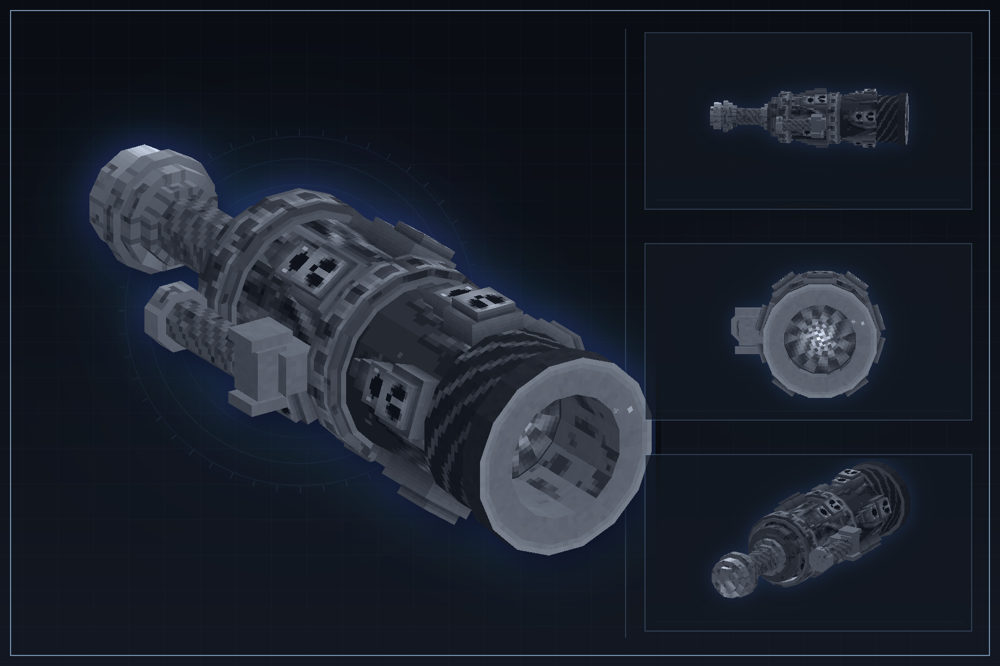

# 冤魂炮（Wraith Cannon）

Minecraft 1.21.1 NeoForge 模组。

## 内容

- 武器显示名：冤魂炮
- 英文显示名：Wraith Cannon
- 模组 ID：`wraith_cannon`
- 模组名称：Wraith Cannon
- 作者：Titop & SillyPaws
- NeoForge：21.1.176
- GeckoLib：4.9.3

## 音效

大部分音效复用原版音效事件（见 `assets/wraith_cannon/sounds.json`），仅「浓雾消散」为自制 ogg。

## 配置

首次运行后生成两个文件：

- `config/wraith_cannon-common.toml`：蓄力时间、冷却、射程、各档伤害、判定范围、穿墙、宠物免伤、手感、持有缓慢等，进游戏后可热改（部分联机项需服务端与客户端一致）。
- `config/wraith_cannon-startup.toml`：近战附加伤害、近战攻速、耐久。这三项要在物品注册时读取，修改后需重启游戏。

每项都有注释。可在「模组列表 → 冤魂炮 → 配置」用 NeoForge 自带界面修改（带中英文名称与提示），
安装 [Configured](https://github.com/MrCrayfish/Configured) 时也会自动识别。
修改默认值后，已生成的配置文件不会被覆盖，删除该文件即可恢复默认。

## 构建

需要 JDK 21。Windows：

```text
gradlew.bat build
```

输出位于 `build/libs/`。

## 展示图素材

以下图片用于模组页面、发布帖和资源展示，不会作为游戏运行时资源加载。

### 武器模型展示图



### 模组封面图


## 许可证

本项目以 MIT 协议发布，见 `LICENSE`。

### 鸣谢
本项目使用AI辅助制作。
架构和设计由我决定，AI 参与了部分实现，所有代码都经人工审查。

Titop — 作者与维护者
SillyPaws是我给本地 AI 编程助手起的名字，用来致敬 LLM 在 coding 中的帮助。
